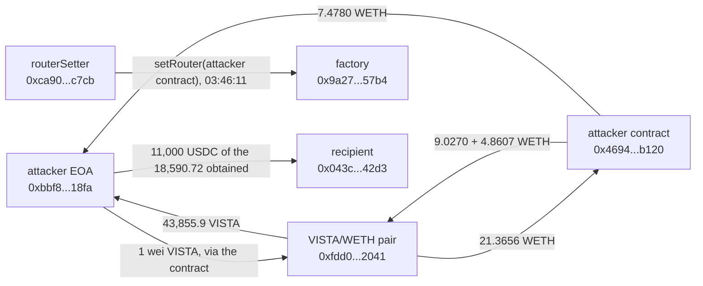

# EtherVista VISTA/WETH Pair Drain, Post-Mortem

On October 9, 2026, at 03:47:59 UTC, one transaction on Ethereum took 7.477952 WETH and 43,855.9 VISTA, 35.0% of the pair's VISTA, out of EtherVista's VISTA/WETH pair. It went through a contract the attacker had deployed 5 minutes 36 seconds earlier and that the factory's own `routerSetter` address had registered as the factory's router 108 seconds before. Only the router can call the pair's `swap()`, and `swap()`'s invariant check multiplies two `uint112` reserves without widening them, so the product wraps and the check passes for a swap that empties the pair.

The WETH leg is worth $18,626 at DefiLlama's price; the VISTA leg, which would add about $17,900, is not counted. DefiLlama lists $18,600 and classes it as an arithmetic error. The press attributes the flaw to an integer overflow in `swap()` and says the attacker's contract was "registered as the authorized router", without saying by whom.

The registry `registre_hypotheses.csv` states each fact as a falsifiable claim with its locator; `reconstruct_exploit.py` re-derives every on-chain number here live, check by check.

## At a glance

| | |
|---|---|
| Victim | EtherVista's VISTA/WETH pair `0xfdd05552f1377aa488afed744c8024358af02041` (token0 WETH, token1 VISTA `0xc9bca88b04581699fab5aa276ccaff7df957cbbf`), that is, its liquidity providers |
| Chain | Ethereum |
| Date | 2026-10-09, 03:47:59 UTC, block 26152259, tx `0xb2c7332d9e1be6a86d9d37083aa4cc0d94b60eb95cc9b29494555a3c09764930` (DefiLlama dates it 2026-10-08) |
| Mechanism | The factory's router, which alone may call `swap()`, was set to the attacker's contract; `swap()` then lets a caller take 21.37 WETH out for 1 wei of VISTA because `reserve0 * reserve1` is computed in `uint112` and wraps below the left side of the check |
| Attacker | EOA `0xbbf8f3fe8e4fdf6b594e6107144d78293d2018fa`, whose first transaction deployed the contract `0x469424b628a9d2036e41496e814db500d683b120` (6,835 bytes, unverified) |
| Router change | `setRouter` signed by the factory's routerSetter `0xca90d843288e35beeadfce14e5f906e3f1afc7cb` at 03:46:11 UTC (to the attacker's contract) and at 03:49:11 UTC (back to `0x9bd63c5d44ff28390df1eaafd4eb4bd73e94a72a`); why it signed is not established |
| Loss | At least 18,626 dollars: 7.477952467865157795 WETH at DefiLlama's price of 2,490.83; the 43,855.9 VISTA taken at the same time are not valued |
| Funds | The EOA turned the proceeds into 18,590.716460 USDC, sent 11,000 USDC to `0x043c8f2df89612f9da2d91a92d30d3295cf842d3` between 05:36 and 05:43 UTC; not traced further. No return was found |
| Press figures | DefiLlama: $18,600 (EtherVista, "Arithmetic Error", Ethereum, source empty). An aggregator page of 2026-10-09 citing SlowMist: about $18.6K, "integer overflow in the EtherVistaPair.swap() function" |

## Timeline (2026-10-09, UTC)

| Time | Block | Event |
|---|---|---|
| 03:42:23 | 26152231 | The attacker's EOA, on its first transaction, deploys `0x4694...b120` |
| 03:43:59 | 26152239 | The EOA buys VISTA through the legitimate router `0x9bd6...a72a` |
| 03:46:11 | 26152250 | The factory's routerSetter calls `setRouter(0x4694...b120)` |
| 03:47:11 | 26152255 | The EOA approves 100 wei of VISTA to `0x4694...b120` |
| 03:47:59 | 26152259 | The exploit, one call to `0x4694...b120` with the VISTA address and 1 |
| 03:49:11 | 26152265 | The routerSetter calls `setRouter(0x9bd6...a72a)` |
| 03:51 to 04:05 | 26152277 to 26152345 | The EOA makes small swaps through the legitimate router, sends 43,930.08 VISTA to the dead address (03:55:47), and unwraps WETH |
| 04:41 to 04:44 | 26152529 to 26152540 | Three Universal Router swaps of ETH for 18,590.716460 USDC |
| 05:36 to 05:43 | 26152802 to 26152835 | Three transfers of USDC, 11,000 in all, to `0x043c...42d3` |

## Fund flow



*Fig. 1: fund flow, addresses truncated for display. All but the first and last step are in one transaction, block 26152259; the last arrow is 11,000 of the 18,590.72 USDC.*

## The method

```bash
python3 reconstruct_exploit.py
```

Standard library only, Ethereum RPC (`eth.drpc.org`, then Tenderly's public gateway), Sourcify and DefiLlama's price API. The call trace needs a node that serves `debug_traceTransaction`; where none does, `--trace-file preuves/trace_calltracer_2026-10-22.json` reads the saved copy. DefiLlama gave a date and an amount and nothing else; the press named the pair's contract, not an address; the pair address was found from the VISTA token's market pages, and the transaction by scanning the pair's WETH transfers out of the pair on October 7 to 9. Everything below was read from the chain.

1. **The transaction** and **the timeline** around it: the contract creation, the two `setRouter` calls, the approval.
2. **The factory's router** at four blocks, and the pair's reserves the block before and the block of the exploit.
3. **The two swaps and the syncs**, from the receipt's logs, and the invariant check recomputed with the exact and the wrapped product.
4. **The sources**: the pair's and the factory's, from Sourcify; the attacker's contract is not verified anywhere read.
5. **The trace**: every call the attacker's contract makes.
6. **After**: the USDC conversions and transfers.

Each is a numbered check (H1 to H16) printed as PASS or FAIL; `--tx <hash>` runs the same checks on any other Ethereum transaction and they fail, see `preuves/temoins_negatifs_2026-10-22.txt`.

## What it found

### The flaw in the pair

`swap()` (source line 611) first requires `msg.sender` to be the factory's router (line 612), then sends the requested tokens before checking anything, then compares the new balances with the stored reserves (line 633):

```
require(balance0 * balance1 >= reserve0 * reserve1, "K");
```

`balance0` and `balance1` are 256-bit values read from the tokens; `reserve0` and `reserve1` are `uint112` state variables (lines 340 and 341), and under Solidity 0.5.16 a product of two `uint112` is computed in `uint112`, so it wraps modulo 2^112 without reverting. The constant-product check of the original design widens the reserves first; this one does not.

| | Value |
|---|---|
| Reserves before (block 26152258) | 21.365578509624935898 WETH, 125,302.577879645672649896 VISTA |
| After the first swap (1 wei VISTA in, 21.365578479614736555 WETH out) | balances 30,010,199,343 wei WETH, 125,302.577879645672649897 VISTA |
| `balance0 * balance1` | 3,760,355,340,359,948,898,430,732,018,417,671 |
| `reserve0 * reserve1`, exact | 2,677,162,065,145,962,451,132,398,363,044,340,796,366,608 |
| `reserve0 * reserve1` in `uint112` | 3,760,355,340,290,237,821,639,216,231,751,440 |

The exact product is about nine orders of magnitude above the left side and would reject the swap; the wrapped one is below it by about 7e22, so the swap passes. The amount taken out leaves the left side just above the wrapped product.

### The order of events inside the transaction

| Step | What the trace shows |
|---|---|
| 1 | The attacker's contract moves 1 wei of VISTA from the EOA to the pair and calls `swap` for 21.365578479614736555 WETH, to itself; the pair is left with 30,010,199,343 wei of WETH |
| 2 | It sends 9.026956903960976779 WETH back to the pair and calls `sync()`: the reserves are now 9.0270 WETH and the unchanged VISTA |
| 3 | It sends 4.860669107788601981 WETH to the pair and calls `swap` for 43,855.902196275763910452 VISTA, to the EOA |
| 4 | It sends the remaining 7.477952467865157795 WETH to the EOA |

The pair ends at 13.887626041759778103 WETH and 81,446.675683369908739445 VISTA: it lost 7.477952467865157795 WETH and 43,855.902196275763910451 VISTA. The second swap passes the check on the exact product as well. The attacker's contract is not verified; its behavior is read from the trace and the logs, not from its code.

### The router

`setRouter` in the factory (verified on Sourcify) requires `msg.sender` to be the `routerSetter`, which the constructor set to the deployer, and the factory has one router for all its pairs. The routerSetter address `0xca90...c7cb` sent `setRouter(0x4694...b120)` at 03:46:11 UTC, which succeeded, and `setRouter(0x9bd6...a72a)` at 03:49:11 UTC, which restored the router that had been in place before.

### After the transaction

The EOA made small swaps through the legitimate router, sent 43,930.080656851986168396 VISTA to the dead address 0x...dead at 03:55:47 (the VISTA it had taken was destroyed, not sold), unwrapped WETH, then swapped 7.47 ETH for 18,590.716460 USDC in three Universal Router transactions and sent 11,000 USDC, in 1,000 and two of 5,000, to `0x043c...42d3`, an EOA.

## Caveats

- **Who signed the first `setRouter`, and why, is not established.** The transactions come from the routerSetter address; who signed it, and in what conditions, was not found, and no statement from EtherVista was found. The same address sent the restoring `setRouter` 72 seconds after the exploit.
- **The attacker's contract is not verified.** The sequence in the trace is what it did; its source, and how it chose the first amount, were not read.
- **The loss is a floor.** Only the WETH leg is valued. The VISTA leg (43,855.9 VISTA, 35.0% of the pair's VISTA) would add about $17,900 at DefiLlama's price of 0.4087, a price taken after the drain on a thin market. The EOA sent it to the dead address instead of selling it, and its realized proceeds, 18,590.72 USDC, are close to the WETH leg alone.
- **Every pair of this factory has the same check** (one factory, one router; the pair code is the one verified here for the VISTA pair); the other pairs were not examined, and exploiting one needs the router to be set by the routerSetter, as here.
- **The first `setRouter` happened after the attacker's contract existed and before the call.** That ordering is read from the timestamps, not from any statement.
- **DefiLlama's date is 2026-10-08**, a day before the transaction; its category (arithmetic error) matches what the chain shows.

## License

MIT, see the repository root.
