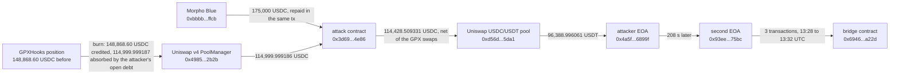

# GoldPesa GPXHooks Drain, Post-Mortem

On October 2, 2026, at 13:05:51 UTC, one transaction on Base took 114,999.999 USDC out of the liquidity that GoldPesa's own Uniswap v4 hook (GPXHooks) manages for its GPX/USDC pool. The attacker ended with 96,388.996061 USDT after swapping the USDC it kept, and sent all of it away 208 seconds later. Counted as the USDC that left the Uniswap v4 PoolManager over the transaction, the loss is $114,536.134217.

DefiLlama lists $114,900 and classes the incident as "Incorrect Share Accounting". What the chain shows is not share accounting: the hook rebalances its liquidity by burning its position and minting a new one through Uniswap's shared PositionManager, and it sized the new position from what it received, without comparing that with what the burned position was worth. In the same transaction the attacker had left an unpaid position in that shared account, and the hook's burn paid for it.

The registry `registre_hypotheses.csv` states each fact as a falsifiable claim with its locator; `reconstruct_exploit.py` re-derives every on-chain number here live, check by check.

## At a glance

| | |
|---|---|
| Victim | GoldPesa's protocol-owned GPX/USDC liquidity on Uniswap v4, managed by the GPXHooks contract `0x4519e2b040ff1b64fa03abe2aef0bc99d7cceaa8` (token GPX `0x454f8c3f1fc79a98363db6104a20ac59a02a3133`) |
| Chain | Base |
| Date | 2026-10-02, 13:05:51 UTC, block 52078502, tx `0x5c1febd5047c2a15c37988b6abd5c8b984236dddf6fd24eed96b0f43951ad2c9` |
| Mechanism | The hook's rebalance burns its liquidity position and mints a new one through the shared PositionManager. The attacker had opened an unpaid position in the same PositionManager account just before; the hook's burn released 148,868.602189 USDC, 114,999.999187 of it cleared that debt, the hook received 33,868.603002 and re-minted only that, and the attacker burned its own position and took 114,999.999186 USDC |
| Attacker | EOA `0x4a5fd2e9357cc87df4cd6a1808174dbc8646899f`; the transaction calls its contract `0x3d69591a3868fe77b531187486862c459cce4e86` (9,182 bytes), funded by a 175,000 USDC Morpho Blue flash loan repaid in the same transaction |
| Loss | 114,536.134217 USDC, the PoolManager's net USDC outflow over the transaction (114,999.999187 drained from the hook's position; the attacker's own swaps of the pool paid part of it back) |
| Attacker's take | 114,428.509331 USDC, swapped for 96,388.996061 USDT in the same transaction; 107.624886 USDC went to the pool's two fee recipients |
| Funds | Sent 208 s later to `0x93ee88a3bc41e98848b9293046756446ce7875bc`, which passed it in three transactions through the bridge contract `0x69460570c93f9de5e2edbc3052bf10125f0ca22d` by 13:32 UTC; not traced further. Nothing was returned |
| Press figures | DefiLlama: $114,900 (GoldPesa, "Token & Share Accounting / Incorrect Share Accounting", Base, source empty). An aggregator page of 2026-10-03 citing SlowMist: about $114.9K, `reBalance()` of GPXHooks not checking currency deltas through its shared PositionManager |

## Fund flow



*Fig. 1: fund flow, addresses truncated for display. The first four steps are in one transaction, block 52078502.*

## The method

```bash
python3 reconstruct_exploit.py
```

Standard library only, Base RPC (`base.drpc.org`, then Tenderly's public gateway), Sourcify's public API. The call trace needs a node that serves `debug_traceTransaction`; where none does, `--trace-file preuves/trace_calltracer_2026-10-21.json` reads the saved copy. DefiLlama gave the date and the amount and nothing else (no address, no link); the transaction was found by scanning Morpho Blue's `FlashLoan` events on Base for USDC loans between $100,000 and $300,000 from 2026-10-01 to 2026-10-04, which leaves one candidate of exactly 175,000 USDC. Everything below was read from the chain.

1. **The transaction**: sender, recipient, block, time, status.
2. **The net flows**: every USDC, GPX and USDT `Transfer` of the receipt, summed per address.
3. **The trace**: the flash loan and every call from the PositionManager to the PoolManager's `modifyLiquidity` and `take`, with the amounts each returned.
4. **The hook**: `lastRebalance()` the block before and the block of the exploit, and Sourcify's record of its source.
5. **After**: the next three steps of the money, a second call to the attack contract, and the current balances.

Each of these is a numbered check (H1 to H14) printed as PASS or FAIL; `--tx <hash>` runs the same checks on any other Base transaction and they fail, see `preuves/temoins_negatifs_2026-10-21.txt`.

## What it found

### The order of events

| Step | What the trace shows |
|---|---|
| 1 | Inside one PoolManager unlock, the attack contract opens position 3106205 in a WETH/USDC pool through the PositionManager and owes 114,999.999187 USDC for it. It pays nothing |
| 2 | Three swaps on the GPX/USDC pool, two buying GPX with USDC and one selling it back (net cost to the attacker 571.489855 USDC). The hook's `beforeSwap` answers each; on the second it runs the rebalance, due because `lastRebalance` was 900,350 seconds old |
| 3 | The hook burns its own position 3078078: the PositionManager's account is credited 148,868.602189 USDC and 40,780.334982 GPX. Its take to the hook is 33,868.603002 USDC, exactly that credit minus the attacker's open debt |
| 4 | The hook mints position 3106206 sized from the 33,868.603002 USDC it holds, with 9,278.120364 GPX |
| 5 | The attack contract burns position 3106205 and takes 114,999.999186 USDC |
| 6 | The flash loan is repaid; the remaining 114,428.509331 USDC is swapped for 96,388.996061 USDT, which goes to the EOA |

The hook's liquidity position held 148,868.602189 USDC before and 33,868.603002 after: a difference of 114,999.999187, the attacker's debt to the cent. The PoolManager's USDC balance fell by 114,536.134217 over the whole transaction, the difference being what the attacker's three swaps paid into the pool (571.489855 net) and the 107.624886 the pool's fee mechanism sent to its two recipients.

The hook's own source (verified on Sourcify) says in its header that it cannot be paused, modified or censored. Its rebalance checks, on the burn, that the position returned at least 99% of the expected amounts; it does not compare what it actually received with that. The USDC it holds afterwards is what sets the size of the new position.

### Where the 114,536 USDC went

| | USDC | Share of the loss |
|---|---|---|
| Attack contract, then swapped for 96,388.996061 USDT | 114,428.509331 | 99.9% |
| Fee recipient `0xdbc69e9a9d61b8f61385d9a748b0542797f27c7a` | 53.812443 | 0.05% |
| Fee recipient `0x14701fd0ce989c66587402512ea9b8fb4a50b85b` | 53.812443 | 0.05% |
| **PoolManager's net USDC outflow** | **114,536.134217** | **100%** |

The two fee recipients are paid by the hook's `beforeSwap` on each swap of the pool; here, on the attacker's three.

### After the transaction

The EOA sent all 96,388.996061 USDT to `0x93ee88a3bc41e98848b9293046756446ce7875bc` 208 seconds later. That address sent it, as 1,000, 10,000 and 85,388.996061 USDT, to a bridge contract that Sourcify holds verified, and holds none now. 69 minutes after the exploit the EOA called its attack contract again; that call reverted and left no log. The EOA's last transaction is dated 2026-10-16.

## Caveats

- **The loss falls on GoldPesa's protocol-owned liquidity.** Who bears it in the end (the treasury, GPX holders) was not established, and no statement from GoldPesa was found.
- **The mechanism is read from the trace and the numbers.** The PositionManager's and PoolManager's source were not re-read here. The claim that the hook's burn absorbed the attacker's debt rests on one equality: the credit the burn returned (148,868.602189) minus the amount the hook received (33,868.603002) is the attacker's debt (114,999.999187), to the unit.
- **Call-level details are withheld.** The hook is immutable by its own account and held a position of 33,868.603002 USDC and 9,278.120364 GPX when the transaction ended. Whether the same sequence still works on it was not tested, and the action codes, ticks, swap sizes and call parameters are not published here. The figures above are enough to check every claim.
- **The valuation counts USDC at face value.** GPX flows are ignored: the GPX that left the PoolManager (31,519.35 over the transaction) went to the hook (31,502.21) and to two fee recipients (17.14), and the hook already holds 99.93 million of the token.
- **The second call to the attack contract reverted** 69 minutes later; why was not established.
- **The bridge's destination was not followed**, and the identity behind the addresses is unknown.
- **DefiLlama's category does not match.** "Incorrect Share Accounting" describes a vault; this is a delta-accounting error in a hook. Its $114,900 is within 0.4% of both the PoolManager's net outflow and the hook's drained position.

## License

MIT, see the repository root.
