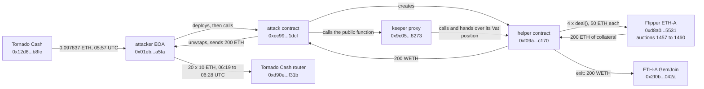

# MakerDAO ETH-A Dormant Keeper Drain, Post-Mortem

On October 6, 2026, at 06:13:11 UTC, one transaction took 200 ETH out of an upgradeable keeper contract that had sat idle since March 2020. The keeper had won four ETH-A liquidation auctions on Black Thursday with a bid of 10^-27 DAI each, never claimed the collateral, and exposed a function that any account could call. A fresh account with two prior transactions called it with a contract it had just deployed, the keeper handed that contract control of its Vat position, and the collateral went out as WETH and then ETH. The MakerDAO core contracts were not part of the exploit path.

Rebuilt from the chain, the loss is 200 ETH, $540,600 at the Chainlink price of the block before. DefiLlama lists $538,000 with an empty source field, which is the same 200 ETH at a slightly lower price. The attacker sent all 200 ETH to Tornado Cash within 16 minutes.

The registry `registre_hypotheses.csv` states each fact as a falsifiable claim with its locator; `reconstruct_exploit.py` re-derives every on-chain number here live.

## At a glance

| | |
|---|---|
| Victim | Keeper proxy `0x9c05a05893ada984fc20d0da0c046de5cc0e8273` (EIP-1967, admin `0x5b492f7483da1778c450b9b18f5df9d95cab8efe`), implementation `0x68399ed8aa33c5b43f863ee6782de492006a5546`, owner `0xadc374e77b89af0b8b39f7c47e8e0a37b6daf073` |
| Chain | Ethereum |
| Date | 2026-10-06, 06:13:11 UTC, block 26131471, tx `0xbb6940f7c2a1e68cafbae7bb9b94d09af9af06ec3a114f6996f2cab993f3a88c` |
| Mechanism | A public function on the keeper handed a caller-supplied contract control of the keeper's Vat position, which then claimed four finished 2020 auctions and withdrew the collateral |
| Attacker | EOA `0x01eb957e5c7dcddd60f3c875956ccc6fb9bda5fa`, attack contract `0xec997d2ad033277913d6002277353368e8321dcf`, helper contract `0xf09a13072ed939b79bc25b66aa3a836ea6dcc170` (created inside the exploit transaction) |
| Taken | 200 ETH of ETH-A collateral: auctions 1457 to 1460 of Flipper `0xd8a04f5412223f513dc55f839574430f5ec15531`, 50 ETH each |
| Loss | 200 ETH = $540,600 (Chainlink ETH/USD 2,703.00 at block 26131470) |
| Funds | Attacker funded 0.097837 ETH from Tornado Cash 16 minutes earlier; all 200 ETH sent to the Tornado Cash router in 20 deposits of 10 ETH, 06:19:35 to 06:28:35 UTC |
| Press figures | DefiLlama: $538,000, "Access Control / Improper Access Control", source field empty. Press: about $538,000, 200 WETH |

## Fund flow



*Fig. 1: fund flow, addresses truncated for display. Times are 2026-10-06 UTC.*

## The method

```bash
python3 reconstruct_exploit.py
```

Standard library only, public RPCs (`eth.drpc.org`, with `gateway.tenderly.co/public/mainnet` as fallback; the call trace needs an endpoint that serves `debug_traceTransaction`) plus Blockscout's public API for address labels and the attacker's history. The press named the transaction; everything else was found from the chain.

1. **The transaction**: sender, target, block, status, and the sender's nonce and code.
2. **The keeper**: EIP-1967 implementation and admin slots, the selectors in the implementation's bytecode, and `owner()` and `authority()` before and after.
3. **The auctions**: Flipper `bids(id)` for ids 1457 to 1460 at the block before and the block of the exploit, and `Vat.gem` for the keeper, the Flipper and the GemJoin.
4. **What moved**, from the transaction's own 16 logs and its call trace: four `deal()` calls, the WETH transfers, the WETH withdrawal and the final ETH transfer.
5. **Valuation**: Chainlink ETH/USD at the block before.
6. **Before and after**: the attacker's balance around the exploit, its 23 transactions and its incoming transfers, with Blockscout's labels for the recipients.
7. **Left over**: the keeper's ETH, WETH and Vat balances today.

No post-mortem from the keeper's operator, MakerDAO or Sky was found. Press figures were read only after the reconstruction.

## What it found

### A keeper that took its caller's word

The implementation contract has the standard `owner()` and `authority()` functions of the `ds-auth` pattern. The proxy's owner is `0xadc374e7...f073`, an account with no code, and the authority is the zero address. The exploit was sent by a different account, with nothing linking it to the owner, and it succeeded. So the function it called did not check who was calling.

The trace shows what the function does with that. It asks a contract the caller supplied for two values, grants that contract access to the keeper's balance in the Vat (`hope`), and calls it. The supplied contract, created a moment earlier inside the same transaction, did the rest on its own. The attack needed no key, no signature and no flaw in MakerDAO's Vat, Flipper or GemJoin: each of them behaved as designed for an account the Vat had been told to trust.

### Collateral waiting for six and a half years

| Fact | Value | Source |
|---|---|---|
| Auctions | 1457, 1458, 1459, 1460 on Flipper ETH-A | `bids(id)` at block 26131470 |
| Lot each | 50 ETH | same |
| Winning bidder (`guy`) | the keeper proxy | same |
| Winning bid | 10^18 rad = 10^-27 DAI | same |
| Tab each | 5,371.431992 DAI | same |
| Last bid | 2020-03-12 15:36:08 UTC | same |
| Auction end | 2020-03-15 15:26:08 UTC | same |
| After the exploit | all four entries empty | `bids(id)` at block 26131471 |

These are the zero-bid auctions of the March 2020 crash: the debt was never covered by the bids, the keeper held the winning bid and nobody called `deal()` to move the collateral to it. The Flipper kept the 200 ETH in its own Vat balance (`Vat.gem(ETH-A, Flipper)` fell from 547.148433 to 347.148433 at the exploit block, exactly 200) until the exploit transaction called `deal()` four times for the keeper. The collateral then went through the Vat to the helper contract, out of the ETH-A GemJoin as 200 WETH, to the attack contract, and was unwrapped.

### Dollar value

200 ETH at the Chainlink ETH/USD answer of 2,703.00 (block 26131470, updated 05:16:23 UTC) is $540,600. DefiLlama's $538,000 corresponds to 2,690 per ETH, so the two figures are the same 200 ETH at different prices. The Index carries the recomputed $540,600.

### Before and after

| Time (UTC) | Event |
|---|---|
| 05:57:23 | Attacker EOA receives 0.097837 ETH from a Tornado Cash pool (`TornadoCash_Eth_01` on Blockscout) |
| 06:09:23 and 06:12:11 | Attacker creates two contracts (nonces 0 and 1) |
| 06:13:11 | Exploit, block 26131471 (nonce 2) |
| 06:19:35 to 06:28:35 | 20 deposits of 10 ETH to the Tornado Cash router (`TornadoRouter` on Blockscout), nonces 3 to 22 |

The attacker holds 0.070091 ETH at the time of this reconstruction and has sent nothing since the last deposit. The keeper proxy holds no ETH, no WETH and no Vat collateral.

## Caveats

- **The implementation has no verified source.** Blockscout shows no source for `0x68399ed8...5546`. The mechanism above is read from the call trace and the bytecode's selector list, not from source. The three selectors the keeper called on the supplied contract are not named here because their signatures are unknown.
- **Other copies of this keeper were not checked.** The implementation may be shared by keepers belonging to other operators. Whether any of them holds funds was not examined.
- **"Dormant" rests on the auction timestamps.** The keeper's own transaction history was not pulled. What is shown is that it won the auctions in March 2020 and that `deal()` had not been called for them until 2026-10-06.
- **Who the loss belongs to is not settled here.** The owner account is named only as the proxy's `owner()`. Whether the collateral belonged to an operator, a pool or an abandoned position was not determined.
- **No recovery found.** The attacker's deposits to the Tornado Cash router leave no on-chain way to trace the funds further, and no return was seen on the attacker address.
- **Dollar value uses one block.** The Chainlink answer of 05:16:23 UTC, about an hour before the exploit.
- **Timing of the alert and the Tornado Cash funding attribution** rest on press and on Blockscout's labels.

## License

MIT, see the repository root.
