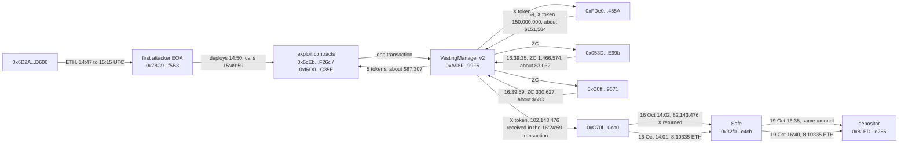

# UNCX Vesting V2, Ethereum Leg, Post-Mortem

On October 14, 2026, at 15:49:59 UTC, one transaction took tokens belonging to other users out of UNCX's VestingManager (v2) on Ethereum. In the next hour three more accounts, none of them the first attacker's address, emptied a 150 million token position and most of what was left of one more token (ZC) from the same contract. Rebuilt from the chain, the contract lost tokens worth about $242,605 on Ethereum alone; 82,143,476 of the X tokens and 8.10335 ETH were later returned (see Returned below), which leaves $139,853. DefiLlama lists $86,000 for the whole incident, which matches the first transaction ($87,307) and none of what came after.

The flaw is in how the contract keeps its share accounting when a vesting position is released and cancelled. No key was involved: the transactions come from ordinary accounts and call the contract's normal functions. UNCX reports four chains affected; only Ethereum is reconstructed here.

The registry `registre_hypotheses.csv` states each fact as a falsifiable claim with its locator; `reconstruct_exploit.py` re-derives every on-chain number here live.

## At a glance

| | |
|---|---|
| Victim | UNCX VestingManager v2, `0xA98F06312b7614523d0f5e725e15fd20fB1b99F5` on Ethereum (verified source, deployed 2025-08-15 in block 23143944, owner `0x31c44A17aa2E639B40f33DA805CB1DB55d969693`) |
| Chain | Ethereum (UNCX and DefiLlama also list Base, BNB Chain and Robinhood Chain; not reconstructed here) |
| Date | 2026-10-14, first drain 15:49:59 UTC, block 26191745, tx `0x352065378c4a41b77e5b6a1e5b5616cd2886c3e1a2c87ed3db8e5ddddc23823d` |
| Mechanism | Share accounting that the release and cancel paths of a vesting position update inconsistently; sequence withheld, see Caveats |
| First attacker | EOA `0x78C9B11853E4f183a34C63fFd1924d2319a2f5B3`, exploit contracts `0x6cEbDf095172B355121b93962017975C4601F26c` and `0xf6D072254Eb8A9B06e0bA21221b498332C1BC35E` |
| Other senders | `0xFDe0d1575Ed8E06FBf36256bcdfA1F359281455A` (X token, block 26191920), `0x053D984Eab3240Cdf7C53b8B7846159f8146E99b` (ZC, block 26191993), `0xC0ffeEBABE5D496B2DDE509f9fa189C25cF29671` (ZC, block 26191995). Nothing in the chain data links them to the first attacker |
| Taken | Six tokens: ZC, X, PAAL, LO0P, PEPECOIN, EDGEN; balance of the contract before the first drain against balance now |
| Loss | $139,853 on Ethereum after the return of 82,143,476 X tokens ($83,011) and 8.10335 ETH ($19,741) (gross $242,605 before them; $159,594 net of the X alone); by transaction, gross: $87,307 in the first, then $151,584 (X token), $3,032 and $683, at DefiLlama's prices for the first drain's time. The X token's price has a confidence of 0.84 and a thin market, so that line is the least certain. A floor for the incident, which also touched three other chains |
| Returned | 82,143,476.362922687 X, about $83,011 at the same price. 2026-10-16 14:02:11 UTC, block 26205564, tx `0xf0ae2cd77698882e35437500891907327765f4e36f33c7dcd88683be7c757301`: from `0xC70f00CD7E461686b04B0E912E309becA8b80ea0`, which had received 102,143,476.362922687 X in the second drain transaction, to the Safe `0x32f0eB068fD804195629A2CBEE30A7e9CE58c4cb`. 2026-10-19 16:38:47 UTC, block 26227870, tx `0x686c704e402fa9d531e87afaec20d36d6ce53851cbac7f4365e5b46823bd753b`: the same amount from that Safe to `0x81EDADbe4a5BaaD8cd5d321547584cB48Fe1d265`, the address that deposited the X in the contract. Both read on three nodes. The X never went back into the contract. The same address also sent 8.10335 ETH (about $19,741 at the ETH price of the same moment) to the same Safe on 2026-10-16 at 14:01:35 UTC, 36 seconds before the X (block 26205561, tx `0x07614e32f26762ef90d3010f8f4460302a6689ab4444c62015fb04cb2edc02d2`); the Safe sent 8.10335 ETH to `0x81EDADbe4a5BaaD8cd5d321547584cB48Fe1d265` on 2026-10-19 at 16:40:59 UTC, two minutes after the X (block 26227881, tx `0xf7cccf72387813d6ecacdb31c05e544ead2b43b50942d2373d790222c3300749`). Read on three nodes |
| Press figures | DefiLlama: $86,000 (UNCX Network V2, "Incorrect Share Accounting", four chains, source empty). Blockaid, via press ([Crypto Briefing](https://cryptobriefing.com/uncx-network-vesting-pool-exploited/), [The Crypto Times](https://www.cryptotimes.io/2026/10/15/uncx-exploit-escalates-vesting-v2-bug-drains-1-5m-across-4-chains-as-copycats-join-in/)): about $86,000 at first, then about $1.49 million across four chains, of which about $242,000 on Ethereum. |

## Fund flow



*Fig. 1: fund flow on Ethereum, addresses truncated for display. The three lower senders acted separately from the first attacker as far as the chain data shows. The last five arrows are the returns of X tokens and ETH (see Returned).*

## The method

```bash
python3 reconstruct_exploit.py
```

Standard library plus `curl` and Foundry's `cast`; public RPC (`gateway.tenderly.co/public/mainnet`), Blockscout's public API and DefiLlama's price API. The press named the victim and the first attacker's addresses; the contract at that address, every transaction and every number came from the chain.

1. **The contract**: verified source from Blockscout, read in full, with its deployment transaction, owner and fee settings. The source is not copied into this repository: its header reserves all rights and forbids copying. Read it at https://eth.blockscout.com/address/0xA98F06312b7614523d0f5e725e15fd20fB1b99F5?tab=contract (API: https://eth.blockscout.com/api/v2/smart-contracts/0xA98F06312b7614523d0f5e725e15fd20fB1b99F5, field `source_code`). The file read on 2026-10-16 is 41,677 bytes with sha256 `6589c5e0fd13b4a225d9372b6c4e516e05ef51c5981ea9750a981edc1847a351`; `curl -s <API url> | python3 -c 'import json,sys,hashlib;print(hashlib.sha256(json.load(sys.stdin)["source_code"].encode()).hexdigest())'` should print the same value if the verified source is unchanged.
2. **Balances**: `balanceOf` of the contract for each of the six tokens at the block before the first drain and at the latest block.
3. **Valuation**: DefiLlama's historical price for each token at the time of the first drain.
4. **Who took what**: every transfer in or out of the contract since 2026-10-14 15:00 UTC, netted per transaction, with each transaction's sender.
5. **The largest line**: the X token drain, checked against the contract's whole deposit history of that token and the events of its transaction.
6. **Current state**: fees, owner and the first attacker's balance today.
7. **Returns**: `python3 verifier_retours.py` reads, on three nodes, the transactions that carried the returned X tokens and ETH, the path of the X from the second drain, the depositor's transfers, the contract's balances at block 26204197 and now, everything that moved at the Safe, and every transfer from the holder to the Safe, the depositor or the contract since the first drain, and values the returns at the same prices (output of 2026-10-21 in `preuves/resultats_retours_2026-10-21.txt`).

UNCX had published no post-mortem when this was written. Press and security-firm statements were read only after the reconstruction.

## What it found

### Someone else's tokens, not the attacker's

The contract is a pool: tokens deposited for vesting sit together and positions hold shares of them. Before the first drain it held 150,000,000 X tokens, 11,025,111 ZC, 57,344,850 EDGEN and smaller amounts of three more. For X, the full deposit history is three deposits from one address in February, May and June 2026, 150,150,150 tokens in all (`preuves/resultats_reconstruction_2026-10-16.txt:25-28`). The contract's balance of it went from 150,000,000 to zero in the block 26191920 transaction. Those tokens belonged to a single outside depositor, and one transaction by an account that had deposited none of them took them all.

### Four transactions, four senders

| Block | Sender | Token | Amount | Value |
|---|---|---|---|---|
| 26191745 | `0x78C9...f5B3` | PAAL, LO0P, PEPECOIN, ZC, EDGEN | 115,945.63 / 65,826.00 / 42,200.53 / 9,131,678.04 / 57,344,850.92 | $87,307 |
| 26191920 | `0xFDe0...455A` | X | 150,000,000 | $151,584 |
| 26191993 | `0x053D...E99b` | ZC | 1,466,574.54 | $3,032 |
| 26191995 | `0xC0ff...9671` | ZC | 330,627.18 | $683 |

A fifth transaction at 03:01 UTC on 15 October moved a net of 496.87 ZC *into* the contract. The values sum to $242,606 against $242,605 from the balance method; the difference is rounding. These are gross figures, before the return of X tokens described above.

### Dollar value, and why the figures differ

DefiLlama's $86,000 is the first transaction: $87,307 at DefiLlama's prices, 1.5% above. The press figure of about $242,000 for Ethereum (Blockaid) matches the balance method to within 0.3%. The $1.49 million is Blockaid's four-chain estimate, which one outlet describes as not confirmed; the Base, BNB Chain and Robinhood Chain legs are not reconstructed here because the contract sits at a different address on each of them and none was named in the sources. The Index carries the Ethereum figure as a floor.

### Where things stand

The contract's fee setting `flatFee()` now returns 2^256 - 1, so no new vesting can be created. The first attacker's address holds 20.237223 ETH at block 26204197 (nonce 26). The contract still holds 96,728.7 ZC and 288.9 PEPECOIN after the drains. UNCX is reported to have offered a bounty for return of funds. On the chain, 82,143,476 X tokens and 8.10335 ETH were returned (see Returned above). Up to block 26240106 (2026-10-21) no other return of the six tokens was seen and the contract's balance of them did not fall again; it received 496.87 ZC (2026-10-15) and 816.41 ZC (2026-10-20), and sent out two tokens outside the six, 100,000 BOBINA (2026-10-17) and 995,000 TCT (2026-10-19), which were not examined.

## Caveats

- **Only Ethereum is reconstructed.** UNCX and DefiLlama list four chains. Blockaid's figures for the other three ($969,000, $169,000, $114,000) are press, not checked here.
- **Mechanism withheld.** The contract's source is public and ExVul and SlowMist have named the category (share accounting between release and cancel). Current patch status not re-verified; details withheld pending disclosure to the team. The number of events per transaction in `preuves/` is shown only to establish that both drains used the contract's normal functions.
- **The contract is not patched by the fee change.** A fee setting only blocks new positions; whether the positions that remain can still be abused was not tested and is not claimed either way.
- **The returns are valued at the same snapshot.** The $83,011 uses the X price of the first drain (confidence 0.84), like the drain it offsets, and the $19,741 the ETH price of the same moment (confidence 0.99); the ETH is not one of the six tokens taken from the contract, but it came from the address that received the X and went to the same depositor, so the counting rule treats it as returned funds ($159,594 if only the X is counted); the returned tokens went to the depositor's address, not back into the contract, and what that address did afterwards is not part of this figure.
- **Prices are one snapshot.** DefiLlama's price at the time of the first drain, for all later transactions as well. The X token has a confidence of 0.84 and a thin market: $151,584 is what the balance was worth at that price, not what anyone could sell it for.
- **Who the later senders are is not established.** They may be unrelated opportunists, a second group or the same operator; the chain data shows only separate senders with no transfers between them.
- **Balance drop is not proceeds.** The figures are what left the VestingManager, valued at one snapshot, not what the senders kept or could sell. The first transaction also moved far larger token amounts through the exploit contract than left the VestingManager's balance.

## License

MIT, see the repository root.
